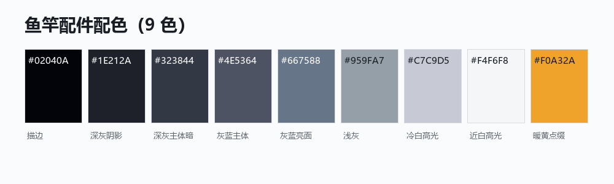

# 冰鹅族 鱼竿配件图标 · 交接包

> 交给外部绘图 AI / 画师。先读本文件，再看图。

---

## 一、这是什么

**RimWorld（环世界）1.7 模组**「冰鹅族 Binguin」里**鱼竿系统的零件图标**。

玩家在「钓竿装配台」上按顺序选 4 类零件，装配成一把完整鱼竿：

```
竿身（长 / 短）
 + 竿头（刀 / 锤）
 + 鱼钩（直 / 弯）
 + 鱼饵
 = 一根完整鱼竿
```

所以要画的是 **7 个小图标**（背包里的零件物品），外加 2 张竿尖特写作为造型依据。

---

## 二、要画的 7 个图标

| 序号 | 名称 | 文件（游戏内） | 造型要点 |
|---|---|---|---|
| 1 | **长制竿身** | `RodShaftLong.png` | 斜向的一根**细长竿身**，两端各有一小段金属箍；比短制长约 1.5 倍 |
| 2 | **短制竿身** | `RodShaftShort.png` | 同款但**明显短粗**，两端金属箍 |
| 3 | **刀制竿头** | `RodTipBlade.png` | **叶片状宽刃**（银白刃面 + 浅色刃口）+ 底部一段**深色刀箍**，刃尖朝上 |
| 4 | **锤制竿头** | `RodTipHammer.png` | **方形锤头**（深灰锤体 + 蓝灰锤面 + 浅色饰块）+ 底部**锤箍** |
| 5 | **直钩** | `RodHookStraight.png` | 鱼钩，**钩尖笔直**，上方一个环形挂孔 |
| 6 | **弯钩** | `RodHookCurved.png` | 鱼钩，**钩身带明显弯曲/倒刺**，同样带挂孔 |
| 7 | **鱼饵** | `RodBait.png` | 一颗**圆形软饵**（蓝灰球体 + 两个彩色点缀），上方一个小卡扣 |

### 竿头造型请对照现有成品

- **08_刀头特写.png** —— 这是「刀制竿头」装到鱼竿上的样子：**叶片刃 + 深色刀箍**，刃面银白、刃口一道浅色线。
- **09_锤头特写.png** —— 这是「锤制竿头」的样子：**方形锤头 + 锤箍 + 一点暖黄装饰**。

> 这两个特写是从已定稿的高级钓竿贴图上裁的，**中间的配件就是目标造型**，两边的竿身/钓线只是上下文。

---

## 三、规格

| 项 | 要求 |
|---|---|
| 最终尺寸 | **64×64**（画 256×256 交付，我来缩） |
| 格式 | PNG，**透明背景** |
| 画风 | **扁平矢量、纯色平涂、粗黑描边**（外轮廓约 64px 时的 2~3px）；**无渐变、无写实渲染、无透视** |
| 角度 | 零件单独看要**一眼认出是什么**；竿身斜放，竿头竖放，钩子竖放 |
| 留白 | 主体占画面 75~85% |

### 配色（只用这些）



| HEX | 用途 |
|---|---|
| `#02040A` | 描边黑 |
| `#1E212A` | 深灰 阴影 |
| `#323844` | 深灰 主体暗部 |
| `#4E5364` | **灰蓝 主体** |
| `#667588` | 灰蓝 亮面 |
| `#959FA7` | 浅灰 |
| `#C7C9D5` | 冷白 高光面 |
| `#F4F6F8` | 近白 最高光 |
| `#F0A32A` | **暖黄点缀**（只用在锤头/卡扣这种小面积） |

> **鱼竿是低科技工具，不要任何蓝色/青色发光**。

---

## 四、直接可用的提示词（复制给绘图 AI）

### 通用前缀

```
游戏物品图标，单个零件，正侧视，扁平矢量风格，纯色平涂，粗黑描边（外轮廓粗、内部细），
右上白色硬高光、右下深色硬阴影，无渐变、无透视、无模糊、无发光。
尺寸 256×256，透明背景，无文字。
配色只用：#02040A 描边、#1E212A 阴影、#323844 深灰、#4E5364 灰蓝主体、
#667588 灰蓝亮面、#959FA7 浅灰、#C7C9D5 冷白高光、#F4F6F8 近白高光、#F0A32A 暖黄点缀。
```

### 1）长制竿身

```
一根细长的鱼竿竿身：斜向放置（从左下到右上），竿体深灰蓝、上沿一道浅色高光；
两端各有一圈银灰色金属箍；整体细长笔直、略带一点弧度。
```

### 2）短制竿身

```
同上，但明显短粗：长度约为长制竿身的 2/3，直径略粗，两端同样有金属箍。
```

### 3）刀制竿头（对照 08_刀头特写.png）

```
一个鱼竿用的刀头配件：底部一段深色圆筒形刀箍，
刀箍上面接一片银白色的叶片状宽刃（刃面有浅色刃口线，右上有高光），
刃尖朝右上，整体像一片竖起来的刀叶。
```

### 4）锤制竿头（对照 09_锤头特写.png）

```
一个鱼竿用的锤头配件：底部一段锤箍，
上面是一个方正的锤头：深灰色锤体、蓝灰色锤面、锤体侧面一小块暖黄色带状装饰。
锤头宽度约为锤箍的 2 倍，正面朝右。
```

### 5）直钩

```
一个金属鱼钩：钩身笔直向下，末端是一个小弯钩与倒刺，钩顶有一个圆形挂孔（用来穿钓线）；
钢青色金属质感，粗描边。
```

### 6）弯钩

```
一个金属鱼钩：钩身明显弯曲（弧形弯曲），钩尖带倒刺，钩顶有圆形挂孔；
比直钩更"弯"、更粗壮，钢青色金属质感。
```

### 7）鱼饵

```
一颗圆形软饵球：蓝灰色球体带高光，表面嵌两个彩色小圆点（暖黄 + 浅青），
上方一个小方形金属卡扣（用来挂到钩上）。
```

---

## 五、注意事项（之前踩过的坑）

| 问题 | 说明 |
|---|---|
| 画风跑偏 | 不要写实金属质感、不要渐变、不要发光 |
| 加了无关元素 | 不要钓线、不要水花、不要鱼、不要星级装饰 |
| 比例失衡 | 竿身别画成一条线（要有厚度），竿头别小到看不出形状 |
| 竿头没有箍 | 刀头/锤头**必须有连接箍**，那是它装到竿上的接口 |
| 颜色越界 | 不要引入紫色、绿色、红色大色块（暖黄只作小点缀） |

---

## 六、包内文件

| 文件 | 说明 |
|---|---|
| `01~07_当前_*.png` | 现在游戏里的 7 个图标（64×64 放大版，**很粗糙，仅供参考位置/类型**） |
| **`08_刀头特写.png`** | **刀制竿头的造型依据**（从成品钓竿上裁的） |
| **`09_锤头特写.png`** | **锤制竿头的造型依据** |
| `10~12_整体鱼竿参考_*.png` | 三把已定稿鱼竿的完整样子（画风基调） |
| `13_配色.png` | 配色卡 |

> `08` / `09` / `10~12` 都是**画风基准**：新画的零件必须和它们站在一起像一套。

## 七、自检

1. 缩到 64×64 还能看出是什么零件吗？
2. 和 `10~12` 的鱼竿放一起，画风、描边粗细、颜色深浅一致吗？
3. 刀头/锤头有没有连接箍？
4. 有没有出现渐变、发光、写实反光？
5. 颜色是否只用了上面 9 个？
